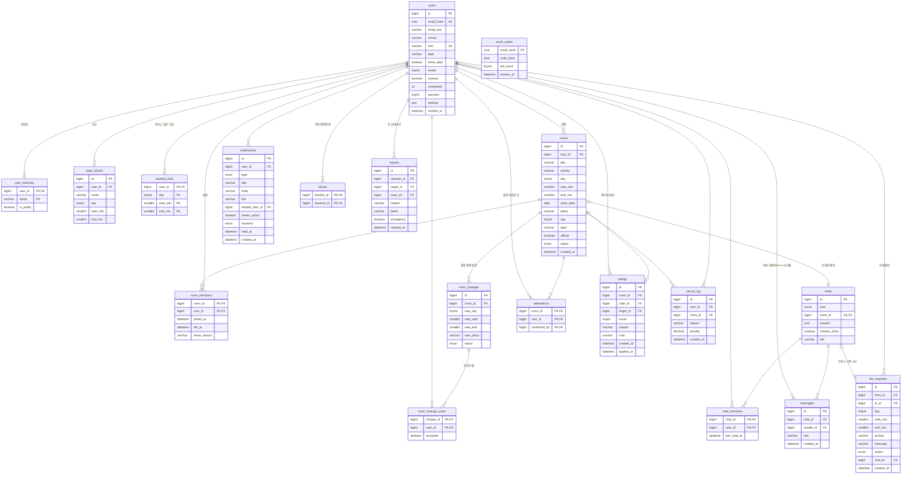

# ERD

DDL은 [backend/src/main/resources/db/schema.sql](../backend/src/main/resources/db/schema.sql)에 있다. GitHub에서 이 파일을 열면 아래 그림이 그려진다.

## 설계 메모

연동 가이드의 18개 테이블을 그대로 따르고, 아래만 바꾸거나 더했다.

| 바꾼 것 | 이유 |
| --- | --- |
| `user_interests` 테이블 추가 (19개) | 피드백: 관심사마다 공개 여부를 정할 수 있어야 함. 추천 이유와 AI 미션에는 `is_public = TRUE`만 사용 |
| `users.email` 대신 `email_hash` + `email_enc` | 피드백: 개인정보 암호화. 로그인 조회와 중복 검사는 해시로, 메일 발송 때만 암호문을 복호화. 해시는 단순 SHA-256이 아니라 서버 비밀키(`EMAIL_HASH_KEY`)를 섞은 HMAC-SHA256. 학교 이메일은 패턴이 단순해서 단순 해시는 전수 대입으로 되돌릴 수 있다 |
| `email_codes`에 `fail_count`, 코드도 해시로 저장 | 5회 실패 시 재발송 규칙, 이메일 원문을 남기지 않기 위해 |
| `ratings.applied_at` 추가 | 피드백: 소규모 모임에서 평가자 유추 방지. 평가를 모아서 크론으로 반영 |
| `dm_requests`에 시간·활동·메시지 추가 | 프론트 `requestDm(userId, slot, activity, message)` 인자 그대로 |
| `dm_requests.chat_id` 추가 | 수락해서 만든 DM 채팅방을 기록. 같은 두 사람의 DM을 또 만들기 전에 이걸로 확인 |
| `rooms.meet_date` 추가 | `day`만으로는 이번 주 모임인지 지난주 모임인지 모른다. 만들 때 서버가 가장 가까운 그 요일 날짜를 넣고, 크론은 `meet_date`가 지난 방을 종료 처리 |
| `chats.mission`을 JSON + `mission_done` | 프론트 `Msg.ai` = 질문 목록 + 미션 + 완료 여부 |
| `users.settings` JSON | 프론트 `settings` (알림 종류별 on/off 등) |
| `notifications.related_user_id` | 프론트 `Notif.userId` |

- 비밀번호 컬럼은 없다. 로그인은 학교 이메일 인증번호 + JWT라서 저장할 비밀번호가 없다.
- 실명과 학번은 저장하지 않는다.
- 모임 목적(친목·취미·스터디)은 따로 컬럼을 두지 않고 `rooms.activity`로 표시한다.
- 시간은 요일(0=월 ~ 4=금) + 분 정수. 공강 겹침은 `day`가 같고 `start_min < 상대.end_min AND end_min > 상대.start_min`.
- `class_blocks`, `wanted_slots`, `rooms`에 `(day, start_min)` 인덱스. 추천에서 `ORDER BY RAND()`는 쓰지 않는다.
- 자기 자신 차단·평가·DM 요청 금지는 서버에서 검사한다. MySQL은 `ON DELETE` 동작이 걸린 FK 컬럼에 CHECK 제약을 걸 수 없다.
- `attendance`의 PK가 `(room_id, user_id, confirmed_by)`인 건 의도한 것이다. 참여자끼리 서로 출석을 확인하고 과반이 확인하면 완료하는 규칙이라 확인자마다 한 줄씩 남는다.
- 평가 반영 기준(미반영 평가가 몇 건 쌓이면, 또는 며칠마다 반영할지)은 4번이 크론 구현 전에 정한다. 1:1이나 3인 모임에서도 유추가 어렵게 최소 건수를 두는 것을 권장.
- `wanted_slots`는 '앞으로 만나고 싶은 공강' 설정이라 주차 구분 없이 덮어쓴다.
- 프론트 이름과 다른 곳: `User.meetups` / `AppState.completed` → `users.completed`, `Room.members` → `room_members`, `Msg.from` → `messages.sender_id`.
